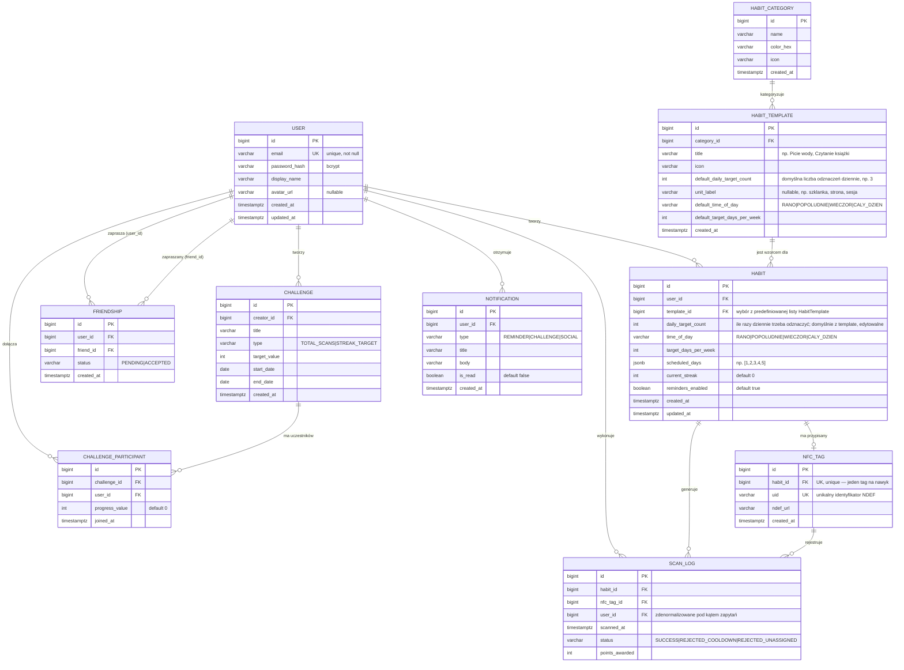

# ERD — Diagram encji i relacji

Diagram bazy danych aplikacji NFC Habit Tracker. Bazowa checklista wymieniała 9 encji (User, HabitCategory, Habit, NfcTag, ScanLog, Friendship, Challenge, ChallengeParticipant, Notification) — dodano 10. encję **HabitTemplate**, żeby wesprzeć katalog predefiniowanych nawyków (wybieranych przez użytkownika z listy, a nie wpisywanych ręcznie) oraz nawyki odznaczane wielokrotnie w ciągu dnia (np. picie wody: 3× dziennie po szklance).

Diagram zapisany jest w formacie **Mermaid** (`erDiagram`) — renderuje się natywnie w podglądzie plików `.md` na GitHub, bez potrzeby zewnętrznych narzędzi. Poniżej znajduje się też źródło do wklejenia w dbdiagram.io/draw.io, jeśli wolisz formę graficzną (PNG) do pracy inżynierskiej.



## Relacje i kardynalność

| Relacja | Kardynalność | Uwagi |
|---|---|---|
| User → Habit | 1—N | Użytkownik ma wiele nawyków |
| HabitCategory → HabitTemplate | 1—N | Kategoria ma wiele wzorców nawyków; 3 domyślne kategorie z migracji `V2__seed_habit_categories.sql` (Etap 2) |
| HabitTemplate → Habit | 1—N | Wzorzec (np. „Picie wody") może być wybrany przez wielu użytkowników jako ich własny `Habit`; katalog wzorców zasilany osobną migracją seedującą (analogicznie do kategorii) |
| Habit → NfcTag | 1—1 (opcjonalna) | `nfc_tag.habit_id` z ograniczeniem `UNIQUE` — jeden aktywny tag na nawyk (zgodnie z regułą z Etapu 2, migracja `V3__add_unique_uid.sql`) |
| Habit → ScanLog | 1—N | Każdy skan (udany i odrzucony) jest logowany |
| NfcTag → ScanLog | 1—N | Historia wszystkich zbliżeń danego tagu |
| User → ScanLog | 1—N | Zdenormalizowane dla szybkich zapytań statystycznych (`GET /api/stats`) bez JOIN-a przez Habit |
| User ↔ User (przez Friendship) | M—N (self-referencing) | `UNIQUE(user_id, friend_id)` zapobiega duplikatom zaproszeń — zgodnie z regułą z Etapu 4 |
| User → Challenge | 1—N | Jako twórca wyzwania (`creator_id`) |
| Challenge → ChallengeParticipant | 1—N | Wielu uczestników na wyzwanie |
| User → ChallengeParticipant | 1—N | Użytkownik może dołączyć do wielu wyzwań; `UNIQUE(challenge_id, user_id)` |
| User → Notification | 1—N | Powiadomienia push/lokalne (Etap 4) |

## Klucze obce — podsumowanie

- `habit.user_id → user.id`
- `habit.template_id → habit_template.id`
- `habit_template.category_id → habit_category.id`
- `nfc_tag.habit_id → habit.id` (UNIQUE)
- `scan_log.habit_id → habit.id`
- `scan_log.nfc_tag_id → nfc_tag.id`
- `scan_log.user_id → user.id`
- `friendship.user_id → user.id`
- `friendship.friend_id → user.id`
- `challenge.creator_id → user.id`
- `challenge_participant.challenge_id → challenge.id`
- `challenge_participant.user_id → user.id`
- `notification.user_id → user.id`

## Mechanika wielokrotnego odznaczania w ciągu dnia

Wprowadzenie `daily_target_count` na `Habit` (np. 3 dla „Picie wody") nie wymaga osobnej tabeli licznika — dzienny postęp wylicza się na bieżąco z istniejącej tabeli `ScanLog`:

```
dzisiejszy_postęp = COUNT(*) FROM scan_log
                    WHERE habit_id = :id
                      AND status = 'SUCCESS'
                      AND scanned_at::date = CURRENT_DATE (w strefie użytkownika)

nawyk_ukończony_dzisiaj = dzisiejszy_postęp >= habit.daily_target_count
```

- Reguła **cooldownu** (min. 5 minut między skanami tego samego tagu, patrz `docs/business-rules.md`) nadal obowiązuje między pojedynczymi odznaczeniami — nie da się „dobić" dziennego celu kilkoma szybkimi stuknięciami pod rząd.
- Reguła **streaka** (wzrost przy wykonaniu w zaplanowanym dniu) sprawdza teraz `dzisiejszy_postęp >= daily_target_count`, a nie sam fakt jakiegokolwiek skanu — dzień liczy się dopiero po osiągnięciu pełnego celu (np. 3/3 szklanek).
- Warto dodać indeks `(habit_id, scanned_at)` na `scan_log` pod kątem wydajności tego zapytania przy większej liczbie użytkowników.
- `unit_label` z `HabitTemplate`/`Habit` jest czysto prezentacyjny (np. UI pokazuje „2 / 3 szklanki") i nie wpływa na logikę backendu.

## Uwaga wdrożeniowa

Diagram zapisano jako `docs/erd.md` (Mermaid) zamiast `docs/erd.png` z dbdiagram.io/draw.io — nie mamy w tym środowisku dostępu do tych narzędzi graficznych. Mermaid renderuje się automatycznie w podglądzie GitHub, więc efekt wizualny jest równoważny. Jeśli do pracy inżynierskiej potrzebujesz pliku PNG, najszybsza droga: otwórz ten plik na GitHub (renderuje diagram), zrób zrzut ekranu, albo wklej blok `mermaid` do [mermaid.live](https://mermaid.live) i wyeksportuj PNG/SVG stamtąd.

`HabitTemplate` będzie wymagać własnej migracji seedującej (analogicznie do `V2__seed_habit_categories.sql`), np. `V2b__seed_habit_templates.sql`, wypełniającej katalog startowy (Picie wody, Czytanie książki, Trening itd. — pokrywa się z listą już używaną w mockach frontendu, `mobile/src/mocks/habits.ts`).
